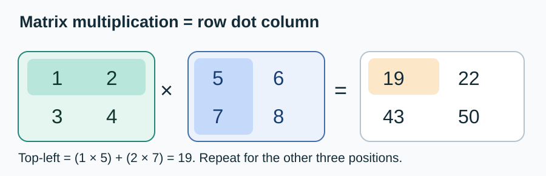
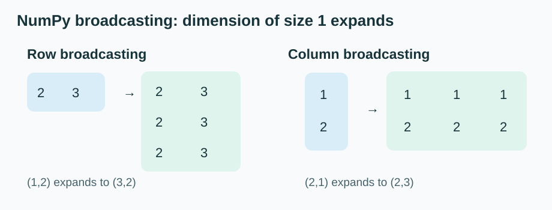

# Matrices for Machine Learning

The concepts practiced on 15 October 2026, explained through calculations and verified in NumPy.

| Order | Lesson |
|---|---|
| 1 | [Shapes and operations](01-shapes-and-operations.md) |
| 2 | [Matrix multiplication](02-matrix-multiplication.md) |
| 3 | [Transpose and matrix–vector multiplication](03-transpose-and-matrix-vector.md) |
| 4 | [Broadcasting and bias](04-broadcasting-and-bias.md) |
| Reference | [Matrix formula cheatsheet](00-formula-cheatsheet.md) |

## Diagrams

The SVG diagrams are text-based, scalable, and render directly on GitHub. NumPy syntax is also collected in the [Python cheat sheet](https://github.com/Vaibh37/Python-cheat_sheet/blob/main/NUMPY_CHEATSHEET.md).

**Next connection:** In a dense neural network layer, matrix multiplication and bias addition happen before activation. See the [hidden-layer forward pass](https://github.com/Vaibh37/Neural-Network/blob/main/notes/04-hidden-layer-forward-pass.md).

**Not covered yet:** inverses, determinants, eigenvectors and decompositions.
