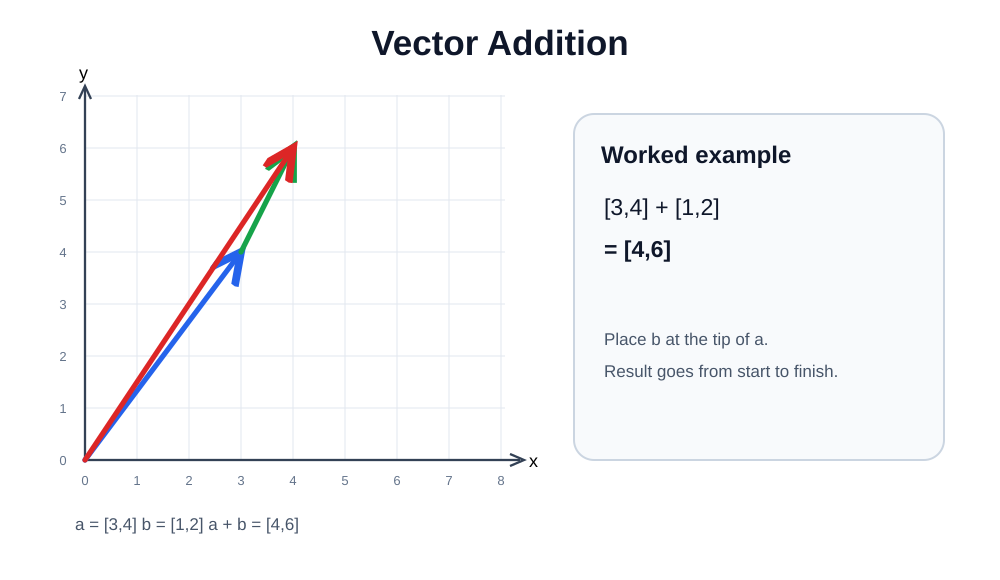
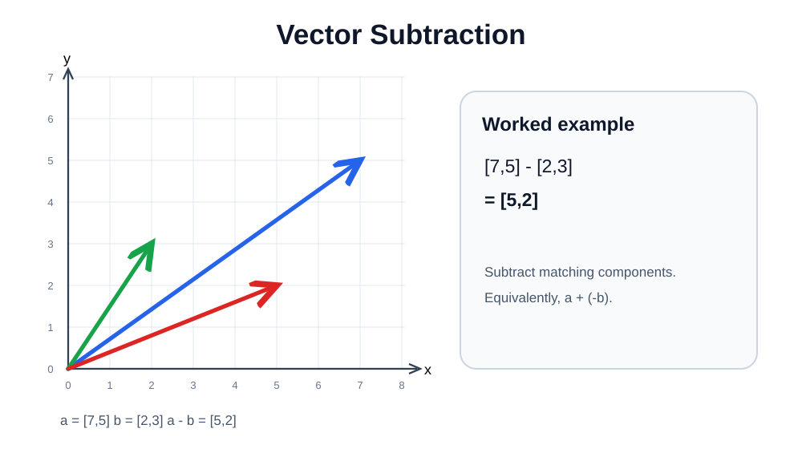

# 02 — Vector Addition and Subtraction

Perform both operations **component by component**. In the ordinary vector arithmetic studied here, the vectors need the same dimension.

## Addition

For $\mathbf a=[3,4]$ and $\mathbf b=[1,2]$:

$$
\mathbf a+\mathbf b=[3+1,4+2]=\boxed{[4,6]}
$$

Geometrically, start the second vector at the first vector's tip (head-to-tail). The resultant goes from the original start point to the final endpoint.

[Edit this diagram in Excalidraw](assets/vector-addition.excalidraw).

## Subtraction

For $\mathbf a=[7,5]$ and $\mathbf b=[2,3]$:

$$
\mathbf a-\mathbf b=[7-2,5-3]=\boxed{[5,2]}
$$

Subtracting $\mathbf b$ is equivalent to adding the opposite vector: $\mathbf a-\mathbf b=\mathbf a+(-\mathbf b)$.

[Edit this diagram in Excalidraw](assets/vector-subtraction.excalidraw).

## 3D example

$$
[1,3,2]+[4,2,5]=[5,5,7]
$$

~~~python
import numpy as np
a = np.array([3, 4])
b = np.array([1, 2])
print(a + b)  # [4 6]
print(a - b)  # [2 2]
~~~

**Common mistake:** Do not sum every component into one number. Addition produces a vector, unlike dot product.
