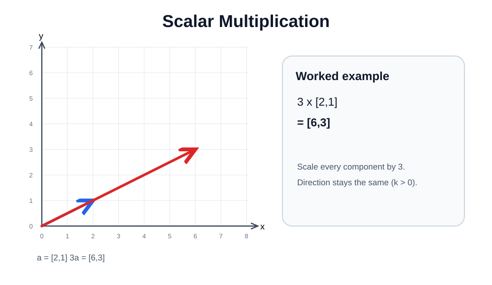
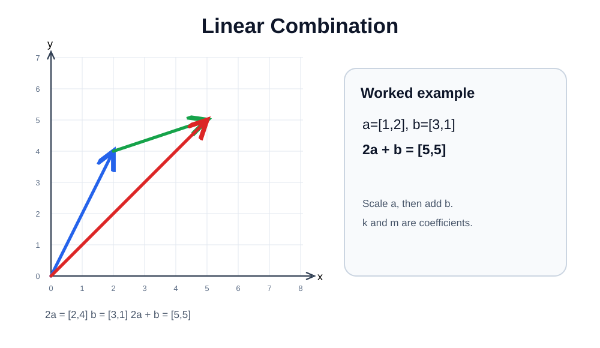

# 03 — Scalar Multiplication and Linear Combinations

A **scalar** is one ordinary number. Multiplying a vector by a scalar multiplies **every component**.

## Scalar multiplication

$$
3[3,4,2]=[3\times3,3\times4,3\times2]=\boxed{[9,12,6]}
$$

Scaling by 2 doubles the vector's magnitude; scaling by $-1$ reverses its direction; scaling by 0 produces the zero vector.

[Edit in Excalidraw](assets/scalar-multiplication.excalidraw).

## Linear combination

A **linear combination** takes scaled vectors and adds them:

$$
k\mathbf a+m\mathbf b
$$

For $\mathbf a=[1,2]$, $\mathbf b=[3,4]$, $k=2$, $m=3$:

$$
2[1,2]+3[3,4]=[2,4]+[9,12]=\boxed{[11,16]}
$$

The values $k$ and $m$ are **not fixed constants**. Sometimes they are supplied in a problem. Other times you solve for them by matching components.

### Finding coefficients from a target

Suppose $\mathbf a=[3,4]$, $\mathbf b=[1,2]$ and you are given:

$$
k\mathbf a+m\mathbf b=[5,8]
$$

Match the first components and second components:

$$
3k+m=5
$$

$$
4k+2m=8
$$

From the first equation, $m=5-3k$. Substitute:

$$
4k+2(5-3k)=8 \Rightarrow -2k=-2 \Rightarrow k=1
$$

Then $m=5-3=2$. Check: $[3,4]+2[1,2]=[5,8]$.

[Edit in Excalidraw](assets/linear-combination.excalidraw).

~~~python
import numpy as np
a = np.array([1, 2])
b = np.array([3, 4])
k, m = 2, 3
print(k * a + m * b)  # [11 16]
~~~

**ML link:** A neuron's weighted sum is a linear combination of its inputs (plus a bias). This is a conceptual connection; it is not a complete neural-network explanation.
