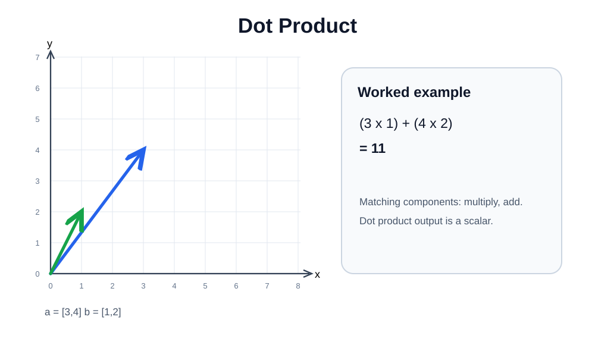

# 04 — Dot Product

The dot product multiplies **matching components** and then **adds** the products. The result is one **scalar**, not a vector.

For $\mathbf a=[3,4]$ and $\mathbf b=[1,2]$:

$$
\mathbf a\cdot\mathbf b=(3\times1)+(4\times2)=3+8=\boxed{11}
$$

Do **not** write $[11]$: square brackets imply a vector containing one component; the actual result here is simply the number $11$.

## 3D example

$$
[1,3,2]\cdot[4,2,5]=(1\times4)+(3\times2)+(2\times5)=4+6+10=\boxed{20}
$$

[Edit in Excalidraw](assets/dot-product.excalidraw).

## NumPy

~~~python
import numpy as np
a = np.array([3, 4])
b = np.array([1, 2])

print(np.dot(a, b))  # 11
print(a @ b)         # 11
~~~

## Why it matters in ML

Weighted sums in neural networks use dot products. For example, if features are $[3,4]$ and weights are $[1,2]$, the weighted sum before bias is $11$.

The geometric interpretation uses $\mathbf a\cdot\mathbf b=\|\mathbf a\|\|\mathbf b\|\cos\theta$. This is a **preview** for the next lesson on angles and cosine similarity.

**Try:** $[2,5]\cdot[3,4]=6+20=26$.
