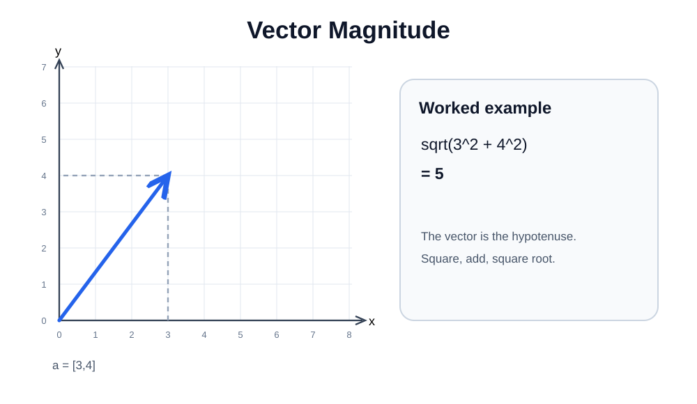

# 05 — Vector Magnitude (Length)

A vector has components and also an overall length called its **magnitude** (Euclidean norm).

## 2D magnitude

For $\mathbf a=[x,y]$:

$$
\|\mathbf a\|=\sqrt{x^2+y^2}
$$

Example:

$$
\|[3,4]\|=\sqrt{3^2+4^2}=\sqrt{9+16}=\boxed5
$$

[Edit in Excalidraw](assets/vector-magnitude.excalidraw).

## 3D magnitude

For $[x,y,z]$:

$$
\|[x,y,z]\|=\sqrt{x^2+y^2+z^2}
$$

Worked example:

$$
\|[2,3,6]\|=\sqrt{4+9+36}=\sqrt{49}=\boxed7
$$

## When it is not a perfect square

$$
\|[2,3]\|=\sqrt{2^2+3^2}=\boxed{\sqrt{13}}
$$

Leave this as $\sqrt{13}$ if an exact answer is required.

~~~python
import numpy as np
print(np.linalg.norm([3, 4]))   # 5.0
print(np.linalg.norm([2, 3]))   # about 3.60555
print(np.linalg.norm([2, 3, 6]))  # 7.0
~~~

**Common mistake:** $x+y$ is not the magnitude. **Square**, add, then take the square root.
