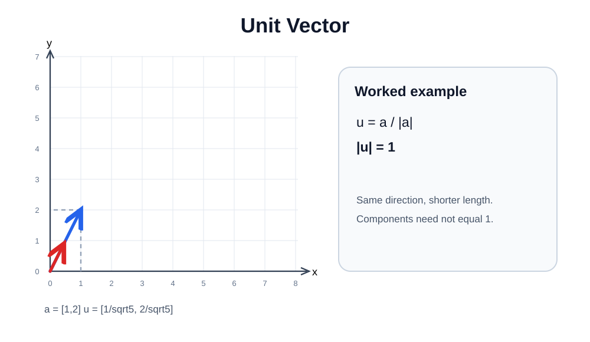

# 06 — Unit Vectors and Normalization

A **unit vector** has **magnitude 1**, regardless of the individual component values. Dividing a nonzero vector by its own magnitude preserves its direction and makes its length exactly 1.

## Formula

$$
\hat{\mathbf a}=\frac{\mathbf a}{\|\mathbf a\|},\qquad \mathbf a\ne\mathbf0
$$

## Worked example with an irrational length: [1,2]

Original length:

$$
\|[1,2]\|=\sqrt{1^2+2^2}=\sqrt5
$$

Normalized vector:

$$
\hat{\mathbf a}=\left[\frac1{\sqrt5},\frac2{\sqrt5}\right]
$$

Verify carefully:

$$
\|\hat{\mathbf a}\|=\sqrt{\left(\frac1{\sqrt5}\right)^2+\left(\frac2{\sqrt5}\right)^2}
=\sqrt{\frac15+\frac45}=\boxed1
$$

[Edit in Excalidraw](assets/unit-vector.excalidraw).

### The important mistake we corrected

The normalized vector $[3/5,4/5]$ has **two components**, $0.6$ and $0.8$. Neither must be 1.

Its **total length** is:

$$
\sqrt{(3/5)^2+(4/5)^2}=\sqrt{9/25+16/25}=\sqrt1=1
$$

When verifying, never forget to **square each component**.

## Another non-perfect-square example

For $\mathbf a=[2,4]$:

$$
\|\mathbf a\|=\sqrt{4+16}=\sqrt{20}=2\sqrt5
$$

$$
\hat{\mathbf a}=\left[\frac2{2\sqrt5},\frac4{2\sqrt5}\right]
=\left[\frac1{\sqrt5},\frac2{\sqrt5}\right]
$$

The magnitude again equals 1.

~~~python
import numpy as np
a = np.array([1.0, 2.0])
norm = np.linalg.norm(a)
unit = a / norm
print(unit)                  # approx [0.4472136 0.89442719]
print(np.linalg.norm(unit))  # approx 1.0
~~~

Floating-point output may be extremely close to 1 rather than exactly 1 due to rounding.

**Zero vector exception:** $[0,0]$ cannot be normalized because its magnitude is 0 and division by zero is undefined.

**ML link:** Normalizing vectors is useful for direction-based comparisons and in many embedding workflows. The details will come with cosine similarity.
